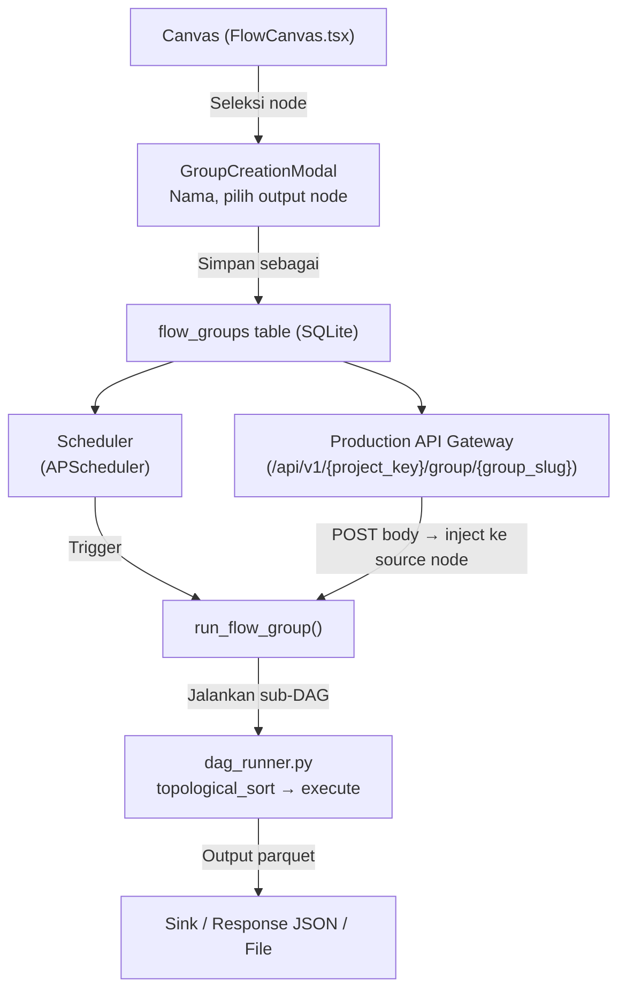
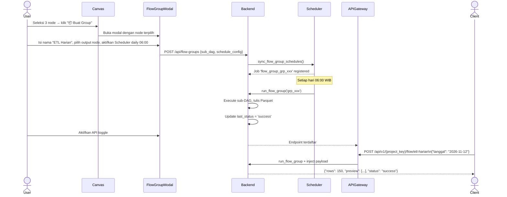

# Plan: Flow Group — Named Sub-DAG dengan Scheduler & API Gateway

## Ringkasan Fitur

Pengguna dapat menyeleksi beberapa node di canvas, membungkusnya menjadi **Flow Group** bernama, lalu:
1. Menyimpan group sebagai sub-DAG yang dapat dijalankan mandiri
2. Menentukan node mana di dalam group sebagai **Input** dan **Output** group
3. Memanggil group tersebut dari **Scheduler** (cron/interval) atau **Production API Gateway** (REST endpoint)

---

## Arsitektur Desain



---

## Komponen yang Diubah

### 🗄️ 1. Database — Tabel Baru `flow_groups`

**File:** [`backend/database.py`](file:///c:/Users/mk.tono.hanito/Documents/PVT-CODE/dataiki/backend/database.py)

```sql
CREATE TABLE IF NOT EXISTS flow_groups (
    group_id      TEXT PRIMARY KEY,          -- 'grp_<uuid12>'
    project_key   TEXT NOT NULL,
    group_name    TEXT NOT NULL,             -- nama display (e.g. "Preprocessing Pipeline")
    group_slug    TEXT NOT NULL,             -- URL-safe slug (e.g. "preprocessing-pipeline")
    description   TEXT DEFAULT '',
    node_ids_json TEXT NOT NULL,             -- JSON array of node IDs dalam group
    output_node_id TEXT NOT NULL,            -- node yang hasil akhirnya jadi output group
    input_node_id  TEXT,                     -- opsional: node sumber yang bisa menerima payload
    sub_dag_json  TEXT NOT NULL,             -- snapshot PipelineDAG (nodes+edges) dari group saja
    schedule_config_json TEXT DEFAULT '{}',  -- ScheduleConfig (sama dgn BatchJob)
    is_api_enabled INTEGER DEFAULT 0,        -- apakah exposed sebagai REST endpoint
    last_run_at   TIMESTAMP,
    last_status   TEXT DEFAULT 'never_run',  -- 'success'|'error'|'running'|'never_run'
    last_error    TEXT DEFAULT '',
    last_output_summary TEXT DEFAULT '',     -- ringkasan hasil terakhir (row count, dsb)
    created_at    TIMESTAMP DEFAULT CURRENT_TIMESTAMP,
    UNIQUE(project_key, group_slug)
);
```

**Auto-migration** ditambah di `init_db()` agar DB lama tidak rusak.

---

### 📐 2. Schemas — Pydantic Contracts Baru

**File:** [`backend/schemas.py`](file:///c:/Users/mk.tono.hanito/Documents/PVT-CODE/dataiki/backend/schemas.py)

```python
class FlowGroupCreate(BaseModel):
    """Payload untuk membuat atau mengupdate flow group."""
    project_key: str
    group_name: str
    group_slug: str                      # auto-generated dari group_name di frontend
    description: str = ""
    node_ids: List[str]                  # daftar node_id yang termasuk group
    output_node_id: str
    input_node_id: Optional[str] = None
    sub_dag: PipelineDAG                 # snapshot sub-DAG (dari frontend)
    schedule_config: ScheduleConfig = Field(default_factory=ScheduleConfig)
    is_api_enabled: bool = False

class FlowGroupRunRequest(BaseModel):
    """Payload untuk run-once trigger atau API call ke flow group."""
    input_payload: Dict[str, Any] = {}   # optional: data di-inject ke input_node
    output_format: Literal["json", "summary"] = "json"  # format respons
```

---

### ⚙️ 3. Engine — Runner Sub-DAG Group

**File baru:** [`backend/engine/flow_group_runner.py`](file:///c:/Users/mk.tono.hanito/Documents/PVT-CODE/dataiki/backend/engine/flow_group_runner.py)

```python
def run_flow_group(group_id: str, input_payload: dict = {}) -> dict:
    """
    Jalankan sub-DAG dari flow group secara mandiri.
    1. Load sub_dag_json dari DB
    2. Jika input_node_id diset dan input_payload tidak kosong:
       - Buat DataFrame in-memory dari input_payload
       - Cache sebagai Parquet di CACHE_DIR/groups/{group_id}/input.parquet
       - Set node input sebagai "file" source pointing ke cache tersebut
    3. Panggil topological_sort + _execute_all_nodes (refactor dari dag_runner)
    4. Baca output Parquet dari output_node_id
    5. Return summary dict: {rows, columns, preview (5 baris pertama), status}
    """
```

> [!NOTE]
> `run_flow_group` memanfaatkan ulang `dag_runner.py` yang sudah ada.
> Karena `topological_sort` dan `_execute_recipe_node` bekerja pada `PipelineDAG`,
> cukup deserialize `sub_dag_json` → `PipelineDAG` lalu jalankan.
> Tidak perlu menulis ulang logika eksekusi.

---

### 🛣️ 4. Backend Routes — CRUD + Trigger + API Gateway

**File baru:** [`backend/routes/flow_group_routes.py`](file:///c:/Users/mk.tono.hanito/Documents/PVT-CODE/dataiki/backend/routes/flow_group_routes.py)

| Method | Path | Fungsi |
|--------|------|--------|
| `GET` | `/api/flow-groups/{project_key}` | List semua group dalam project |
| `POST` | `/api/flow-groups` | Buat group baru |
| `PUT` | `/api/flow-groups/{group_id}` | Update nama / konfigurasi |
| `DELETE` | `/api/flow-groups/{group_id}` | Hapus group |
| `POST` | `/api/flow-groups/{group_id}/run` | Run-once manual trigger |
| `GET` | `/api/flow-groups/{group_id}/status` | Status last run |

**Endpoint Production Gateway (wildcard, di `gateway_routes.py`):**

```
GET/POST  /api/v1/{project_key}/flow/{group_slug}
```

- Mengambil row dari `flow_groups` berdasarkan `project_key` + `group_slug`
- Memverifikasi `is_api_enabled = 1`
- Inject `request.json()` sebagai `input_payload`
- Memanggil `run_flow_group(group_id, input_payload)`
- Return JSON output dari output node

---

### ⏰ 5. Scheduler — APScheduler Integration

**File:** [`backend/engine/job_scheduler.py`](file:///c:/Users/mk.tono.hanito/Documents/PVT-CODE/dataiki/backend/engine/job_scheduler.py)

Tambah fungsi `sync_flow_group_schedules()` mirip dengan `sync_apscheduler_jobs()` yang sudah ada:

```python
def sync_flow_group_schedules() -> None:
    """
    Sinkronkan semua flow group yang punya schedule_config enabled
    ke APScheduler singleton.
    Job ID: 'flow_group_{group_id}'
    """
```

Panggil `sync_flow_group_schedules()` bersamaan dengan `sync_apscheduler_jobs()` saat startup.

---

### 🎨 6. Frontend — Canvas Group UI

#### 6a. Tombol "Buat Group" di Toolbar Canvas

**File:** [`frontend/src/components/devlab/FlowCanvas.tsx`](file:///c:/Users/mk.tono.hanito/Documents/PVT-CODE/dataiki/frontend/src/components/devlab/FlowCanvas.tsx)

- Tambah tombol **"📦 Buat Group"** di toolbar canvas (muncul hanya jika ≥2 node terpilih via `selectedNodes`)
- Klik → buka `FlowGroupModal`

#### 6b. Modal Pembuatan / Edit Group

**File baru:** [`frontend/src/components/devlab/FlowGroupModal.tsx`](file:///c:/Users/mk.tono.hanito/Documents/PVT-CODE/dataiki/frontend/src/components/devlab/FlowGroupModal.tsx)

Fields:
- **Nama Group** → auto-generate slug (URL-safe, lowercase, hyphen)
- **Deskripsi** (opsional)
- **Node Output** → dropdown dari node yang terpilih
- **Node Input** → dropdown (opsional, untuk inject payload)
- **Expose sebagai API?** → toggle ON/OFF
- **Jadwalkan?** → toggle + ScheduleConfig picker (sama dengan Batch Job UI)
- **Preview node terpilih** → list chip node yang masuk group

#### 6c. Visual Group Node di Canvas

**File:** [`frontend/src/components/devlab/CustomNodes.tsx`](file:///c:/Users/mk.tono.hanito/Documents/PVT-CODE/dataiki/frontend/src/components/devlab/CustomNodes.tsx)

Tambah `GroupNode` custom node type:
- Render sebagai kotak border-dashed dengan nama group
- Badge status: `🟢 Aktif API` / `📅 Scheduled` / `⚪ Manual`
- Tombol ▶ Run sekarang, ⚙ Edit, 🗑 Hapus
- Output handle bisa disambungkan ke node lain (opsional chaining antar group)

#### 6d. Sidebar Palette

**File:** [`frontend/src/components/devlab/SidebarPalette.tsx`](file:///c:/Users/mk.tono.hanito/Documents/PVT-CODE/dataiki/frontend/src/components/devlab/SidebarPalette.tsx)

Tambah seksi **"Flow Groups"** di sidebar palette:
- List semua group yang sudah dibuat di project
- Drag & drop `GroupNode` ke canvas untuk menyambungkan antar group

#### 6e. API Client

**File:** [`frontend/src/api/client.ts`](file:///c:/Users/mk.tono.hanito/Documents/PVT-CODE/dataiki/frontend/src/api/client.ts)

```typescript
// Flow Group CRUD
listFlowGroups(projectKey: string): Promise<FlowGroup[]>
createFlowGroup(payload: FlowGroupCreate): Promise<FlowGroup>
updateFlowGroup(groupId: string, payload: Partial<FlowGroupCreate>): Promise<FlowGroup>
deleteFlowGroup(groupId: string): Promise<void>
runFlowGroup(groupId: string, inputPayload?: Record<string, unknown>): Promise<FlowGroupRunResult>
getFlowGroupStatus(groupId: string): Promise<FlowGroupStatus>
```

#### 6f. Types

**File:** [`frontend/src/types/dataiki.ts`](file:///c:/Users/mk.tono.hanito/Documents/PVT-CODE/dataiki/frontend/src/types/dataiki.ts)

```typescript
interface FlowGroup {
  group_id: string;
  project_key: string;
  group_name: string;
  group_slug: string;
  description: string;
  node_ids: string[];
  output_node_id: string;
  input_node_id?: string;
  sub_dag: PipelineDAG;
  schedule_config: ScheduleConfig;
  is_api_enabled: boolean;
  last_run_at?: string;
  last_status: 'success' | 'error' | 'running' | 'never_run';
  last_output_summary: string;
}
```

---

## Alur Kerja Pengguna



---

## Urutan Implementasi

| # | File | Pekerjaan | Estimasi |
|---|------|-----------|----------|
| 1 | `backend/database.py` | Tambah tabel `flow_groups` + auto-migration | Kecil |
| 2 | `backend/schemas.py` | `FlowGroupCreate`, `FlowGroupRunRequest` | Kecil |
| 3 | `backend/engine/flow_group_runner.py` | **File baru**: `run_flow_group()` | Sedang |
| 4 | `backend/engine/job_scheduler.py` | `sync_flow_group_schedules()` | Kecil |
| 5 | `backend/routes/flow_group_routes.py` | **File baru**: CRUD + run-once | Sedang |
| 6 | `backend/routes/gateway_routes.py` | Tambah wildcard `/flow/{group_slug}` | Kecil |
| 7 | `backend/main.py` | Register router baru | Sangat kecil |
| 8 | `frontend/src/types/dataiki.ts` | `FlowGroup`, `FlowGroupCreate` types | Kecil |
| 9 | `frontend/src/api/client.ts` | 6 fungsi API client | Kecil |
| 10 | `frontend/src/components/devlab/FlowGroupModal.tsx` | **File baru**: Form modal | Sedang |
| 11 | `frontend/src/components/devlab/CustomNodes.tsx` | `GroupNode` visual | Kecil |
| 12 | `frontend/src/components/devlab/FlowCanvas.tsx` | Tombol "Buat Group", register edge type | Kecil |
| 13 | `frontend/src/components/devlab/SidebarPalette.tsx` | Seksi "Flow Groups" | Kecil |
| 14 | `npm run build` | Verifikasi TypeScript + Vite | — |

> [!IMPORTANT]
> **Urutan ini sudah dependency-safe**: DB → Schema → Engine → Routes → Frontend.
> Jangan lewati auto-migration agar DB lama yang sudah ada `projects`, `batch_jobs`, dsb tidak rusak.

---

## Batasan & Keputusan Desain

> [!NOTE]
> **Sub-DAG adalah snapshot**: Saat group dibuat, `sub_dag_json` adalah salinan
> dari node-node terpilih pada saat itu. Jika pengguna mengubah node di canvas utama,
> group **tidak otomatis sinkron** — pengguna harus klik "Update Group" di modal.
> Ini sengaja untuk **immutability production** (konsisten dengan model versioning).

> [!TIP]
> **Chaining antar group**: `GroupNode` di canvas punya output handle standar,
> sehingga bisa disambungkan ke node lain atau ke `GroupNode` lain.
> `run_flow_group` mendukung `input_payload` sebagai inject ke `input_node_id`,
> memungkinkan chaining group via API (output group A → input group B).

> [!WARNING]
> **Satu output node per group**: Group hanya punya satu output node.
> Jika pengguna ingin dua output, buat dua group yang berbeda yang berbagi node upstream.

> [!CAUTION]
> **API Gateway & Auth**: Endpoint `/api/v1/{project_key}/flow/{group_slug}` saat ini
> mengikuti pola gateway yang sudah ada (tanpa auth tambahan).
> Jika ingin API-key protection, perlu middleware auth terpisah (di luar scope plan ini).
